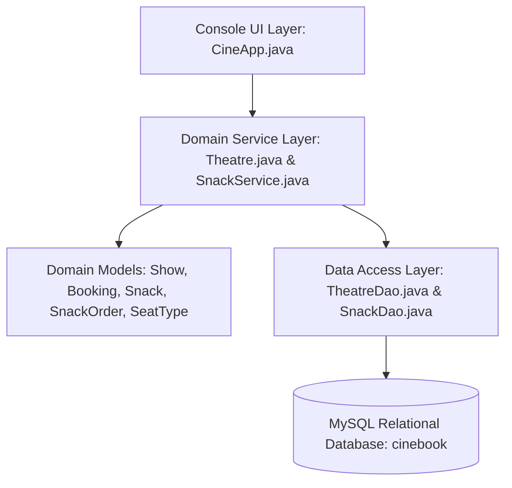
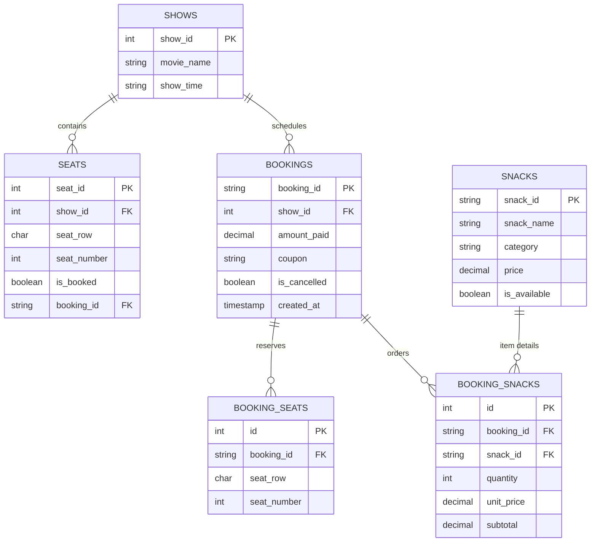

# 🎬 CineBook — Cinema Ticket & Snack Booking System

[](https://openjdk.org/)
[](https://www.mysql.com/)
[](https://docs.oracle.com/javase/8/docs/technotes/guides/jdbc/)
[](#system-architecture)
[](#license)

> **CineBook** is an enterprise-grade Java console application designed for single-screen cinema ticketing and food/beverage ordering. Backed by a persistent **MySQL relational database**, the application demonstrates core computer science and software engineering principles: **Object-Oriented Programming (OOP)**, **Data Access Object (DAO) architecture**, **ACID-compliant transactions**, **deterministic row-level locking (`SELECT ... FOR UPDATE`)**, and **defensive input validation**.

---

## 📌 Table of Contents

1. [Executive Summary](#-executive-summary)
2. [Key Engineering Highlights](#-key-engineering-highlights)
3. [System Architecture](#-system-architecture)
4. [Database Design & ER Diagram](#-database-design--er-diagram)
5. [Pricing & Business Logic](#-pricing--business-logic)
6. [OOP & Design Patterns Implemented](#-oop--design-patterns-implemented)
7. [Project Structure](#-project-structure)
8. [Setup & Installation](#-setup--installation)
9. [Running the Application](#-running-the-application)
10. [Automated Test Suite](#-automated-test-suite)
11. [Sample Console Execution](#-sample-console-execution)
12. [Future Enhancements](#-future-enhancements)
13. [License](#-license)

---

## 📖 Executive Summary

Modern point-of-sale and reservation systems demand high data integrity, resilience against concurrent resource contention, and clean separation between business logic and presentation. **CineBook** provides an end-to-end simulation of a cinema booking engine, allowing moviegoers to:
- Browse movie showtimes and interactive real-time seat grids.
- Reserve seats across multiple tiers (Regular, Premium, VIP).
- Order snacks and beverages from a dynamic MySQL-driven menu with full shopping cart management (review, modify quantities, remove items).
- Apply promotional coupon codes with tier-specific discount rules.
- Cancel bookings with transactional seat release and 80% refund calculation while maintaining audit history.

---

## 🚀 Key Engineering Highlights

- 🔒 **Single-Transaction Atomicity**: All operations of a booking—seat locking, booking creation, seat reservation mapping, and snack order persistence—execute within a **single JDBC transaction**. Any runtime failure initiates an immediate, clean rollback.
- 🛡️ **Deadlock-Free Row-Level Locking**: Concurrent booking requests for overlapping seats are serialized using `SELECT ... FOR UPDATE` with deterministically sorted seat keys, eliminating database deadlocks and race conditions.
- 🍿 **Dynamic MySQL Snack Point-of-Sale**: Snack items, categories, and prices are dynamically fetched from MySQL (not hardcoded). Orders preserve the historical unit price and subtotal at the moment of checkout.
- 🎟️ **Strict Domain Pricing Policy**: The promotional discount (`CINE10` = 10%) applies strictly to the **ticket subtotal**. Snacks are exempt from ticket discounts.
- ⚡ **Idempotent Schema & Seeding**: The application self-heals by idempotently verifying and populating necessary shows, seats, and snack items on launch without duplicating existing records.
- 🛑 **Fail-Fast Connectivity**: Validates the MySQL connection upon startup, offering clear diagnostic hints rather than silently falling back to inconsistent memory states.

---

## 🏛 System Architecture

The project adheres to a multi-layered design emphasizing **Separation of Concerns (SoC)**:



1. **Presentation Layer (`CineApp`)**: Handles console I/O, format rendering, and user input validation loops without containing raw SQL or domain pricing formulas.
2. **Domain Service Layer (`Theatre`, `SnackService`)**: Coordinates domain actions, validates quantities, manages the in-memory snack cart, and coordinates transactions.
3. **Data Access Layer (`TheatreDao`, `SnackDao`)**: Encapsulates all JDBC interactions, SQL prepared statements, connection handling, and transaction lifecycle (`commit` / `rollback`).
4. **Domain Model Layer (`Booking`, `Show`, `Snack`, `SnackOrder`, `SeatType`)**: Encapsulates business rules, pricing computations, seat map representations, and immutable state.

---

## 🗄 Database Design & ER Diagram

The database schema (`cinebook`) comprises 6 relational tables and an auto-increment sequence table:



### Relational Schema Summary

| Table | Primary Key | Foreign Keys / Constraints | Purpose |
|---|---|---|---|
| **`shows`** | `show_id` | `UNIQUE(movie_name, show_time)` | Stores cinema movie titles and show timings. |
| **`booking_seq`** | `id` | `AUTO_INCREMENT = 1001` | Generates collision-safe IDs formatted as `CB1001`, `CB1002`, etc. |
| **`bookings`** | `booking_id` | `FK(show_id) -> shows(show_id)` | Stores confirmed bookings, amount paid, and cancellation status. |
| **`seats`** | `seat_id` | `FK(show_id)`, `FK(booking_id)`, `UNIQUE(show_id, seat_row, seat_number)` | Tracks live seat availability (`O` = free, `X` = booked). |
| **`booking_seats`** | `id` | `FK(booking_id)`, `UNIQUE(booking_id, seat_row, seat_number)` | Maps booked seats to their specific booking reference. |
| **`snacks`** | `snack_id` | `PRIMARY KEY (snack_id)` | Catalog of available snacks, categories, and unit prices. |
| **`booking_snacks`** | `id` | `FK(booking_id)`, `FK(snack_id)`, `UNIQUE(booking_id, snack_id)`, `CHECK(quantity > 0)` | Stores itemized snack orders with historical unit prices preserved. |

---

## 💰 Pricing & Business Logic

### 1. Ticket Pricing Hierarchy (`SeatType` Enum)
Ticket prices are governed by the `SeatType` Java enum (never hardcoded in DB):

| Rows | Seat Tier | Price Per Seat |
|:---:|:---:|:---:|
| **A – B** | `REGULAR` | **Rs. 150** |
| **C – D** | `PREMIUM` | **Rs. 250** |
| **E** | `VIP` | **Rs. 400** |

### 2. Snack Menu Catalog (`snacks` Table)
Retrieved dynamically from MySQL on customer request:

| Snack ID | Item Name | Category | Unit Price |
|:---:|---|:---:|:---:|
| **S001** | Popcorn | Regular | Rs. 120 |
| **S002** | Cheese Popcorn | Premium | Rs. 180 |
| **S003** | Nachos | Snacks | Rs. 150 |
| **S004** | French Fries | Snacks | Rs. 100 |
| **S005** | Veg Sandwich | Food | Rs. 130 |
| **S006** | Chicken Sandwich | Food | Rs. 170 |
| **S007** | Coke | Beverage | Rs. 80 |
| **S008** | Sprite | Beverage | Rs. 80 |
| **S009** | Mineral Water | Beverage | Rs. 40 |

### 3. Financial Calculation Model
$$\text{Final Amount} = (\text{Ticket Subtotal} - \text{Ticket Discount}) + \text{Snack Subtotal}$$

- **Coupon Discount (`CINE10`)**: 10% discount applied strictly to the **Ticket Subtotal**. Snack orders do not receive ticket discounts.
- **Cancellation Policy**: Customers may cancel any active booking. Reserved seats are freed immediately, snack audit records are preserved, and an **80% refund** of the total amount paid (tickets + snacks) is issued. Duplicate cancellations are strictly rejected.

---

## 🧩 OOP & Design Patterns Implemented

| Software Engineering Concept | Implementation Location | Engineering Purpose |
|---|---|---|
| **Data Access Object (DAO)** | [`TheatreDao.java`](file:///c:/CineBook/src/TheatreDao.java), [`SnackDao.java`](file:///c:/CineBook/src/SnackDao.java) | Decouples low-level SQL and connection handling from high-level business logic. |
| **Interface Polymorphism** | [`Bookable.java`](file:///c:/CineBook/src/Bookable.java), [`Show.java`](file:///c:/CineBook/src/Show.java) | `Show implements Bookable`, enforcing a contract for seat reservation and cancellation. |
| **Enum Encapsulation** | [`SeatType.java`](file:///c:/CineBook/src/SeatType.java) | Binds seat row boundaries and rupee pricing within a type-safe constant domain. |
| **Method Overloading** | [`Booking.java`](file:///c:/CineBook/src/Booking.java), [`TheatreDao.java`](file:///c:/CineBook/src/TheatreDao.java) | Flexible calculation signatures (`calculateTotal()`, `calculateTotal(coupon)`, `calculateTotal(coupon, snacks)`). |
| **Encapsulation & Immutability** | [`Snack.java`](file:///c:/CineBook/src/Snack.java), [`SnackOrder.java`](file:///c:/CineBook/src/SnackOrder.java) | Immutable fields for identifiers and pricing; controlled mutation via validated setters. |
| **Transactional Two-Phase Commit** | [`TheatreDao.java`](file:///c:/CineBook/src/TheatreDao.java) | Validates and locks rows using `SELECT ... FOR UPDATE` before batch-inserting records and committing. |
| **Defensive Exception Handling** | [`CineApp.java`](file:///c:/CineBook/src/CineApp.java) | Custom input loops catch `InputMismatchException` and format errors without terminating the CLI. |

---

## 📂 Project Structure

```
CineBook/
├── database/
│   └── schema.sql                 # Complete MySQL DDL & idempotent seed script
├── lib/
│   └── mysql-connector-j-8.3.0.jar# Official MySQL JDBC Driver
├── out/                           # Compiled Java bytecode (.class files)
├── src/
│   ├── Bookable.java              # Interface defining booking operations
│   ├── Booking.java               # Booking entity & pricing calculation engine
│   ├── CineApp.java               # Application entry point & interactive CLI
│   ├── DatabaseConfig.java        # JDBC configuration & environment loader
│   ├── SeatType.java              # Enum: REGULAR, PREMIUM, VIP
│   ├── Show.java                  # Show entity & seat grid matrix rendering
│   ├── Snack.java                 # Entity representing a snack menu item
│   ├── SnackBookingTests.java     # Automated test suite (12 test scenarios)
│   ├── SnackDao.java              # Persistence layer for snack menu & orders
│   ├── SnackOrder.java            # Value object for ordered items and historical pricing
│   ├── SnackService.java          # Snack business rules & shopping cart management
│   ├── Theatre.java               # Orchestration service for shows and bookings
│   └── TheatreDao.java            # Core persistence layer: shows, seats, transactions
└── README.md                      # Project documentation & presentation manual
```

---

## 🛠 Setup & Installation

### 1. Prerequisites
- **Java Development Kit (JDK)**: JDK 17 or higher (Java 21 LTS verified).
- **MySQL Database Server**: Version 8.0 or higher.
- **Git** (for version control).

### 2. Environment Configuration (Optional)
By default, [`DatabaseConfig.java`](file:///c:/CineBook/src/DatabaseConfig.java) connects to `localhost:3306/cinebook` using `root` / `root`. You can override these using environment variables:

| Environment Variable | Description | Default Fallback |
|---|---|---|
| `DB_URL` | JDBC Connection String | `jdbc:mysql://localhost:3306/cinebook?useSSL=false&allowPublicKeyRetrieval=true&serverTimezone=UTC` |
| `DB_USER` | MySQL Username | `root` |
| `DB_PASSWORD` | MySQL Password | `root` |

### 3. Database Initialization
Run the initialization script from the terminal to create the database, tables, and seed records:

```powershell
# Windows (PowerShell)
Get-Content database\schema.sql | mysql -u root -p
```

```bash
# Linux / macOS (Bash)
mysql -u root -p < database/schema.sql
```

---

## 💻 Running the Application

### Windows (PowerShell)

```powershell
# 1. Compile all source files into the out/ directory:
javac -cp "lib/mysql-connector-j-8.3.0.jar;." -d out (Get-ChildItem -Path src -Filter *.java | ForEach-Object { $_.FullName })

# 2. Launch the console application:
java -cp "out;lib/mysql-connector-j-8.3.0.jar" CineApp
```

### Linux / macOS (Bash)

```bash
# 1. Compile:
javac -cp "lib/mysql-connector-j-8.3.0.jar:." -d out src/*.java

# 2. Launch:
java -cp "out:lib/mysql-connector-j-8.3.0.jar" CineApp
```

---

## 🧪 Automated Test Suite

CineBook includes a standalone test suite covering **12 critical verification scenarios** across database operations, concurrency, discounts, and rollbacks.

### Running the Test Suite

```powershell
# Windows PowerShell
java -cp "out;lib/mysql-connector-j-8.3.0.jar" SnackBookingTests
```

```bash
# Linux / macOS Bash
java -cp "out:lib/mysql-connector-j-8.3.0.jar" SnackBookingTests
```

### Test Coverage Matrix

| Test Scenario | Verification Objective | Result |
|---|---|:---:|
| **1. Snack Menu Retrieval** | Verifies retrieval of all 9 items and unit prices from MySQL | `PASS` |
| **2. Quantity Validation** | Rejects zero and negative quantities with `IllegalArgumentException` | `PASS` |
| **3. Subtotal Calculation** | Accurately aggregates subtotals during cart addition, modification, and removal | `PASS` |
| **4. Ticket & Snack Total** | Calculates un-discounted combined ticket and snack totals correctly | `PASS` |
| **5. Coupon Discount Policy** | Verifies `CINE10` discounts ticket subtotal only; snacks pay full price | `PASS` |
| **6. Booking with Snacks** | Validates atomic persistence across `bookings`, `booking_seats`, and `booking_snacks` | `PASS` |
| **7. Booking without Snacks** | Confirms normal ticket booking operates seamlessly without snack records | `PASS` |
| **8. Transaction Rollback** | Verifies complete database rollback and seat unlocking upon constraint failure | `PASS` |
| **9. Cancellation & Refund** | Verifies seat freeing, historical snack preservation, and 80% refund computation | `PASS` |
| **10. Historical Price Integrity** | Guarantees existing booking prices remain unchanged if menu prices are altered | `PASS` |
| **11. Duplicate Snack Prevention** | Aggregates duplicate items into single line items in the cart | `PASS` |
| **12. Concurrency Conflict Safety** | Verifies row-level lock rejects simultaneous booking of occupied seats | `PASS` |

---

## 🖥 Sample Console Execution

### 1. Booking Confirmation (Tickets + Snacks + Coupon)
```text
==================================================
              BOOKING CONFIRMATION
==================================================
Booking ID       : CB1001
Movie            : Inception
Show Time        : 10:30 AM
Seats            : C3, C4

---------------- TICKET DETAILS ------------------
Ticket Subtotal  : Rs. 500

---------------- SNACK DETAILS -------------------
Popcorn        x2  : Rs. 240
Coke           x2  : Rs. 160

Snack Subtotal   : Rs. 400

---------------- PAYMENT DETAILS -----------------
Coupon           : CINE10
Ticket Discount  : Rs. 50
Final Amount     : Rs. 850
==================================================
Thank you for booking with CineBook!
==================================================
```

### 2. Cancellation Receipt (80% Refund)
```text
==================================================
              CANCELLATION RECEIPT
==================================================
Booking ID       : CB1001
Movie            : Inception
Show Time        : 10:30 AM
Seats freed      : C3, C4
Snack items      : 2 item(s) preserved
Amount Paid      : Rs. 850
Refund (80%)     : Rs. 680
==================================================
```

---

## 🔮 Future Enhancements

- 💳 **Payment Gateway Integration**: Mock payment processing with UPI / Card validation hooks.
- 🏢 **Multi-Screen Multiplex Support**: Expanding schema to handle multiple auditoriums and dynamic seating layouts.
- 📱 **QR Code Ticket Generation**: Generating printable QR codes storing the booking reference and snack token.
- 🌐 **RESTful Web API Layer**: Exposing Spring Boot endpoints for mobile and web frontends while retaining the core domain engine.

---

## 📄 License

This project was developed for academic, portfolio, and educational purposes. You are free to study, fork, and adapt it.
